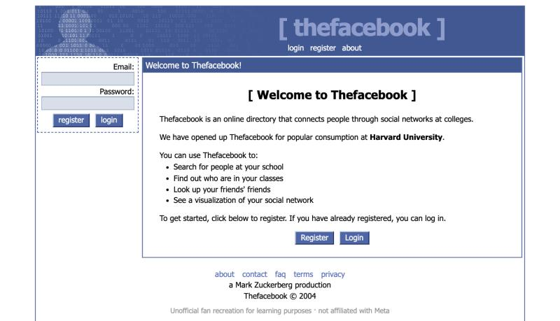
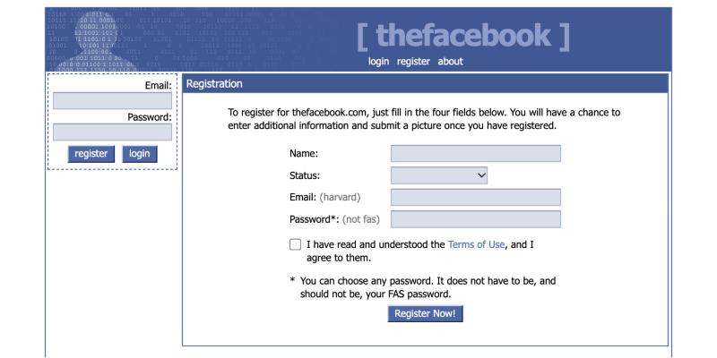
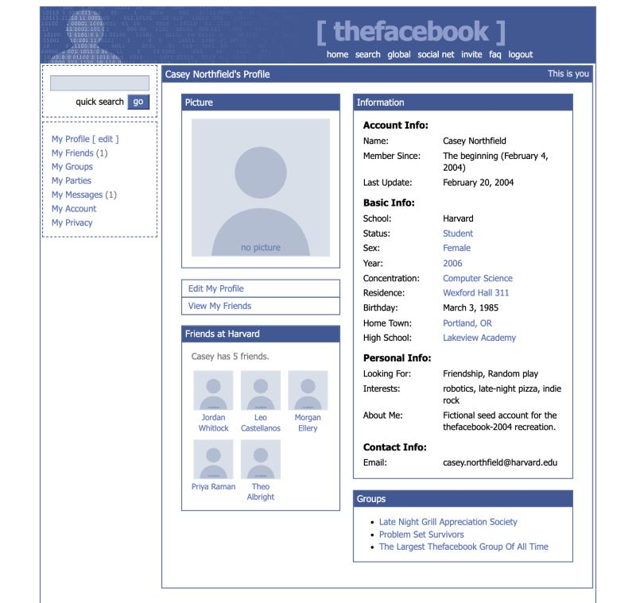
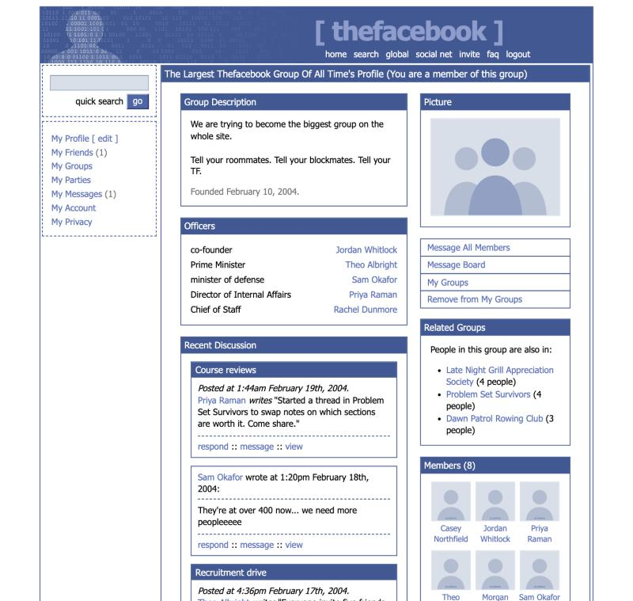
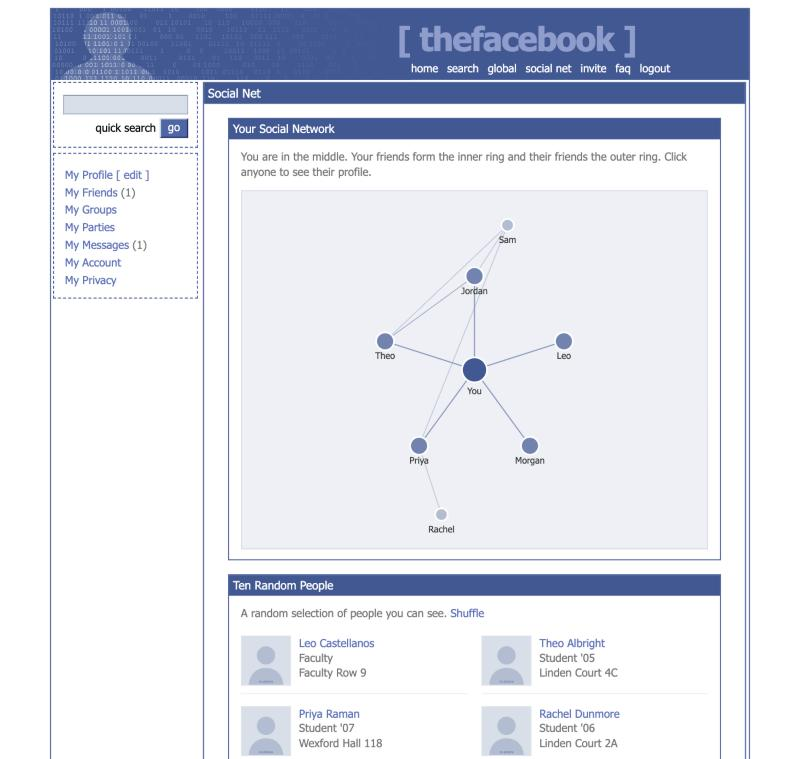
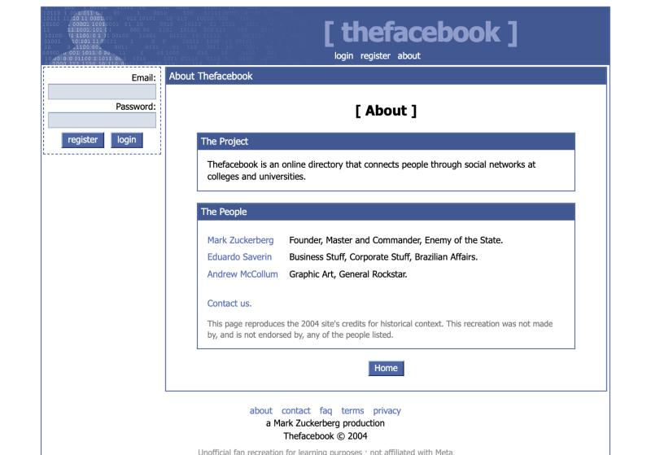
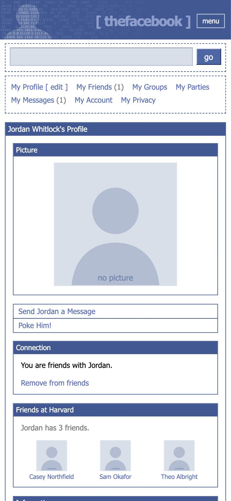

# thefacebook-2004

> **Disclaimer:** This repository is a clone, not the real site. It is an unofficial fan
> recreation of "thefacebook" as it looked at launch in February 2004, built for learning and
> nostalgia. It is not affiliated with or endorsed by Meta Platforms, Inc. "Facebook" is a
> trademark of Meta. Run it locally only; do not host it publicly under the Facebook name.



## Screenshots

| Registration | Profile |
|---|---|
|  |  |
| **Group** | **Social net** |
|  |  |
| **About** | **Mobile** |
|  |  |

All people, groups and posts shown are fictional sample data.

## How it was built

- **Design** recreated by hand from screenshots of the 2004 site. The header graphic and avatars
  are original SVG artwork.
- **Stack:** plain PHP 8 (no framework), SQLite via PDO, one CSS file and one small JavaScript
  file. No build step, no dependencies.
- **Features:** registration, login, profiles with picture upload, search, friends, messages,
  pokes, groups and the "social net" view.
- **Improvements over the original:** responsive layout for phones, hashed passwords, CSRF
  protection and escaped output.

## Install and run locally

### 1. Install PHP 8.1+ and Git

**Windows**
1. Install Git from <https://git-scm.com/download/win>.
2. Download the latest PHP 8 **VS16 x64 Non Thread Safe** zip from
   <https://windows.php.net/download> and extract it to `C:\php`.
3. Add `C:\php` to your `PATH` (Start → "Edit the system environment variables" →
   Environment Variables → `Path` → New).
4. In `C:\php`, copy `php.ini-development` to `php.ini`, open it, and remove the leading `;`
   from these lines:
   ```ini
   extension_dir = "ext"
   extension=gd
   extension=mbstring
   extension=pdo_sqlite
   ```
5. Open a **new** PowerShell window and check: `php -v`

**macOS** ([Homebrew](https://brew.sh))
```bash
brew install php git
```

**Linux (Ubuntu/Debian)**
```bash
sudo apt install php-cli php-sqlite3 php-gd php-mbstring git
```

### 2. Clone and start

These commands are the same on Windows (PowerShell), macOS and Linux:

```bash
git clone https://github.com/mohakamran/thefacebook-2004.git
cd thefacebook-2004
php -S localhost:8000 -t public
```

Open <http://localhost:8000>. Press `Ctrl+C` in the terminal to stop the server.

### 3. Log in

- Sample account: `casey.northfield@harvard.edu` / `poke2004`
- Or register your own. Like the original, only `@harvard.edu` addresses are accepted (no email
  is sent, so it need not be real). To allow any address, set `ALLOWED_EMAIL_DOMAIN` to `''` in
  `src/bootstrap.php`.

### Reset

The database is created automatically on first run. To start fresh, stop the server and delete
`data/thefacebook.sqlite*` and any images in `public/uploads/` (keep `.gitkeep`).

### Troubleshooting

- **`php` is not recognized** (Windows): `C:\php` is not on your `PATH`, or the terminal was
  opened before you changed it. Open a new terminal.
- **"needs these PHP extensions enabled"**: enable the listed extensions in the `php.ini` shown in
  the message, then restart the server.
- **"Address already in use"**: another program uses port 8000. Use another port, e.g.
  `php -S localhost:8080 -t public`.
